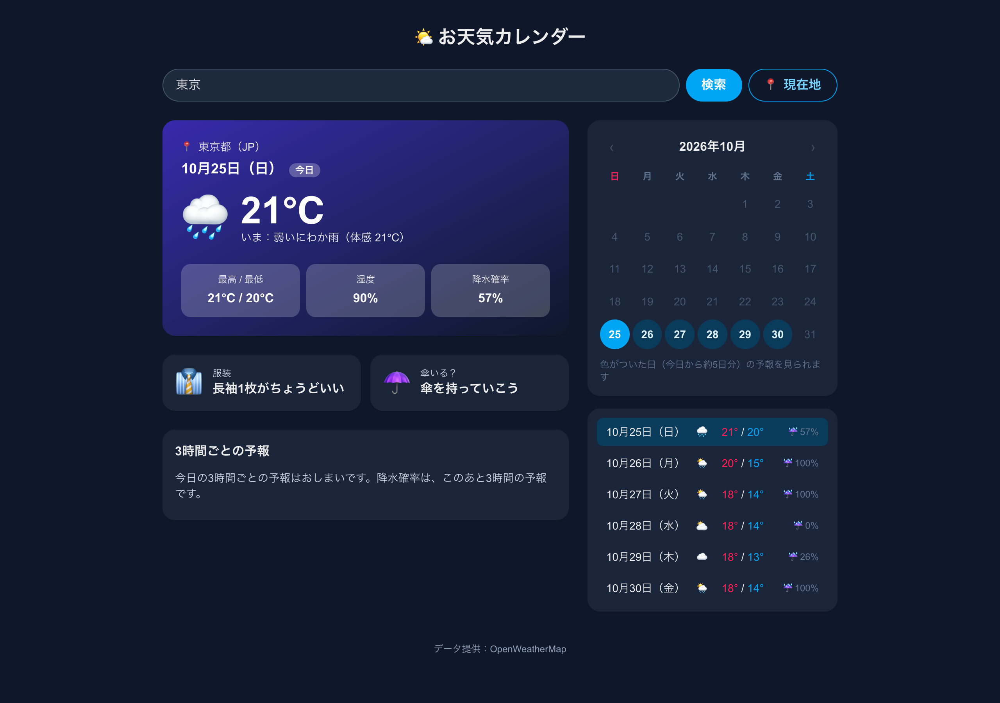
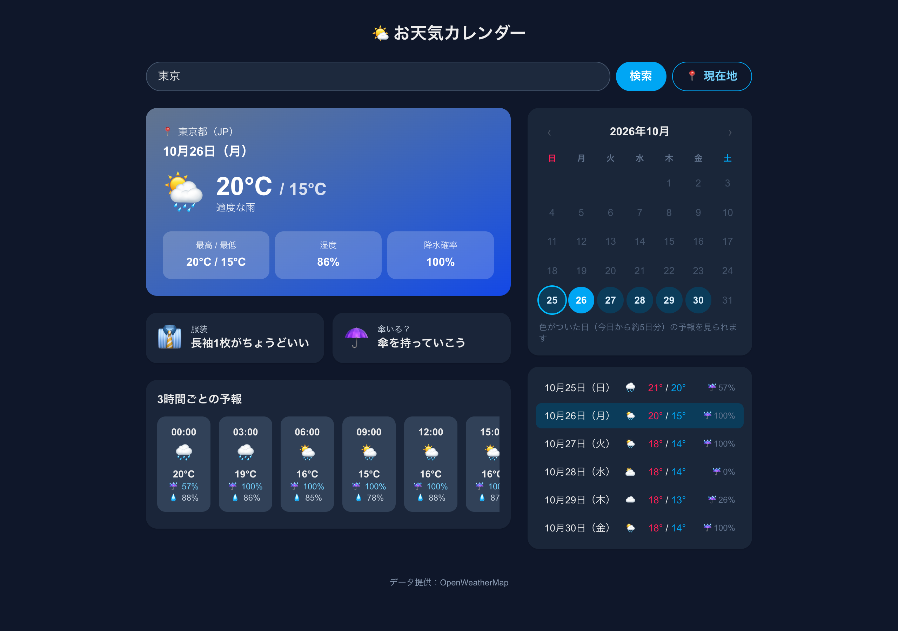
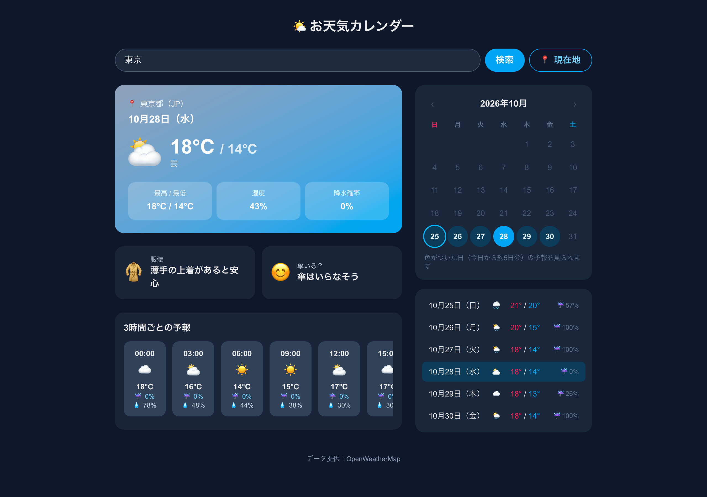
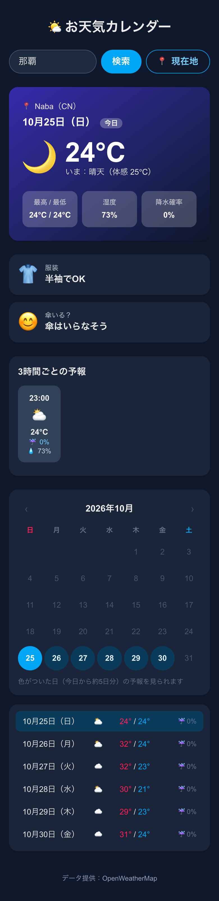
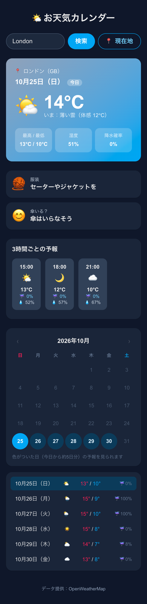

# [課題提出] 天気予報アプリに3つの機能を追加する実装課題を完成させました

> このファイルは提出記事の原稿です（`zsh docs/kadai3/copy_article.sh` で写真ごとコピーできます）。

## A. 課題概要

### 課題情報

- 課題名：実践編 課題1-0-3　課題1・2で作ったアプリそれぞれに、自分で考えた3つのアイディアを追加実装しよう（天気予報アプリ編）
- 難易度：★★☆☆☆（5段階で自己評価）

### 課題要件

- 各アプリに対して、3つの追加機能アイディアを自分で考える（ChatGPT に相談するのは OK）
- 各アイディアについて、「誰の」「どんな課題を」「どう解決するか」を1行ずつ書き出してから実装する
- 3つすべて、実際に動く形で実装する
- 更新したアプリを Vercel に再デプロイする（push すれば自動更新）

### ソースコード

- GitHub：https://github.com/Usuke3122378/weather-next
- Google Drive：なし
- 公開URL：https://weather-next-blond.vercel.app/

### 成果物のスクリーンショット

開いたときの画面（PC・東京・10月25日の夜）。天気カードのすぐ下に「服装」と「傘いる？」のカードが並ぶ。夜なので天気カードの背景が紺色になっている

週間のまとめから10月26日（雨・降水確率100%）を選んだところ。背景が雨の濃い青に変わり、「傘を持っていこう」と出る

10月28日（くもり・降水確率0%）を選んだところ。背景がグレーがかった青になり、「傘はいらなそう」と出る。最高気温18℃なので服装は「薄手の上着があると安心」

スマホで「那覇」を検索したところ。体感温度が高いので「半袖でOK」と出る

スマホで「London」を検索したところ（現地は昼）。昼のくもりの背景になり、服装は「セーターやジャケットを」。スマホでは2つのカードを縦に並べている

## B. 実装内容

### 使用技術

- 言語：TypeScript
- フレームワーク：Next.js（App Router）、React、Tailwind CSS
- データベース：なし
- その他ツール：OpenWeatherMap（無料プラン。前回の課題で使ったものをそのまま利用）、Claude Code（アイディア出し・実装・動作確認・スクショ撮影）、GitHub（コード保管）、Vercel（push すると自動で公開し直す）

### 実装した機能

1. 服装アドバイス
    - 誰の：朝、出かける準備をする人の
    - どんな課題を：気温を見ても、何を着ればいいか迷う
    - どう解決するか：今日は体感温度、ほかの日は最高気温から、「半袖でOK」「長袖1枚がちょうどいい」「薄手の上着があると安心」「セーターやジャケットを」「コートが必要」「厚手のコートとマフラーを」の6段階で表示する
2. 傘いる？判定
    - 誰の：通勤・通学する人の
    - どんな課題を：降水確率の数字だけだと、傘を持っていくか決めにくい
    - どう解決するか：降水確率が50%以上なら「傘を持っていこう」、30%以上なら「折りたたみ傘があると安心」、それ未満なら「傘はいらなそう」と表示する
3. 天気で背景が変わる
    - 誰の：アプリを使う人みんなの
    - どんな課題を：天気カードの色がいつも同じで、ひと目では天気がわからない
    - どう解決するか：天気カードの背景色を天気に合わせて変える（晴れは青→黄、くもりはグレー→青、雨は濃い青、雷は紫、雪は水色、霧はグレー、夜は紺）

### 工夫したポイント

- 前回の課題で取れていたデータ（気温・体感温度・降水確率・天気アイコン）だけで作りました。新しい API を呼ばないので、無料プランの回数も増えず、表示も遅くなりません。
- 今日は「いまの体感温度」、ほかの日は「最高気温」で服装を決めています。今日は実際に外に出たときの感じ方に近い体感温度が、先の日は予報の最高気温がわかりやすいと考えました。
- 判定の決まり（何℃なら何を着るか、何%なら傘か）は、`src/lib/weather.ts` に関数として分けました。数字を変えたいときは、そこだけ直せば済みます。
- 背景色は、OpenWeatherMap の天気アイコンのコード（例：`10d` は昼の雨、`01n` は夜の晴れ）で切り替えています。前回、絵文字を出すのに使ったコードと同じものを使っています。
- カレンダーや週間のまとめで日付を選ぶと、服装・傘・背景もその日に合わせて変わります。
- スマホでは「服装」と「傘いる？」のカードを縦に並べて、文字が折れないようにしました。

## C. 実装過程

### 開発の流れ

#### 10月25日（1）追加する機能を考える

やったこと：課題文を Claude Code に貼り付けて、「おすすめの機能を10個あげてください」と頼んだ。出てきた10個から、服装アドバイス・傘いる？判定・天気で背景が変わる、の3つを選んだ。

遭遇したエラー：`（エラーはなし）`

Cursorに聞いた内容：（今回は Claude Code に相談）天気アプリに追加するおすすめの機能を10個聞いた。

Cursorの回答：（Claude Code の回答）今のコードを読んで、すでにある機能（都市検索・現在地・カレンダー・3時間ごとの予報・ダークモード）以外から、服装アドバイス・傘判定・洗濯指数・お気に入り都市・気温グラフなど10個を、「誰の・どんな課題を・どう解決するか」と難しさつきで表にしてくれた。服装・傘・背景の3つは、今取れているデータだけで作れるので簡単、とのことだった。

実際に試したこと：

1. 3つを選んで、「最短で作成してください」と頼んだ
    - 結果：判定の関数3つと、画面のカード2つ・背景の切り替えが追加された。型チェック・lint・ビルドが通り、push して Vercel に公開された

学んだこと：「誰の・どんな課題を・どう解決するか」を先に書くと、何を作るかがはっきりして、話がそれない。

---

#### 10月25日（2）スマホで服装の文字が3行に折れた

やったこと：Claude Code に、公開版をスマホ幅（390px）で開いて、ロンドンなど何都市か検索したところのスクショを撮ってもらった。

遭遇したエラー：`（エラーはなし）スマホで「服装」と「傘いる？」のカードが横に2つ並んでいて、「セーターやジャケットを」が3行に折れていた`

Cursorに聞いた内容：（Claude Code がスクショを確認）

Cursorの回答：（Claude Code の回答）スマホの幅で2つのカードを横に並べると、1つが狭すぎる。スマホでは縦に並べ、画面が広いとき（`sm:` 以上）だけ横に並べる。

実際に試したこと：

1. カードの並べ方を `grid-cols-2` から `sm:grid-cols-2` に直して push し、スクショを撮り直した
    - 結果：スマホでは縦に並び、文字が1行に収まった

学んだこと：PC で問題なくても、スマホ幅で見ると崩れていることがある。前回の課題と同じで、公開したあとにスマホ幅でも確かめる。

---

#### 10月25日（3）背景がちゃんと変わるかを確かめる

やったこと：Claude Code に、週間のまとめの日付を1日ずつ押して、そのたびに「服装・傘・背景の色」を書き出してもらった。

遭遇したエラー：`（エラーはなし）`

Cursorに聞いた内容：（Claude Code に）すべての日で、表示と背景が予報どおりに変わるか確認してほしいと頼んだ。

Cursorの回答：（Claude Code の回答）東京は、今日（夜・雨）が紺、26・27・30日（雨・降水確率100%）が濃い青で「傘を持っていこう」、28・29日（くもり・降水確率0%と26%）がグレー→青で「傘はいらなそう」になっている。那覇は「半袖でOK」、ロンドンは「セーターやジャケットを」と、都市によって服装も変わっている。

実際に試したこと：

1. 雨の日・くもりの日・那覇・ロンドンのスクショを撮って、見比べた
    - 結果：天気によって背景と表示が変わっていた

学んだこと：日付や都市を変えたときの結果を一覧にしてもらうと、全部を自分で押して確かめなくても、まとめてチェックできる。

---

### 参考にした資料

- 公式ドキュメント：なし（前回の課題で作ったコード〈天気アイコンを絵文字にする関数〉を参考にした）
- 参考記事：
- 動画教材：

## D. 学習の振り返り

### 今回学んだこと

技術的な学び：

- 新しいデータを取らなくても、今あるデータ（気温・降水確率など）の見せ方を変えるだけで、使う人が「どうすればいいか」まで伝えられる
- 判定の決まりを関数に分けておくと、画面のコードを触らずに数字だけ直せる
- Tailwind CSS では、`sm:grid-cols-2` のように書くと、スマホでは縦・PC では横、と画面の幅で並べ方を変えられる
- OpenWeatherMap の天気アイコンのコードは、天気の種類（`01` 晴れ、`10` 雨など）と昼夜（`d`／`n`）がわかるので、色分けにも使える

AIツールの使い方：

- 「今のコードを読んでからおすすめを出して」と頼むと、もうある機能とかぶらないアイディアが出てくる
- アイディアを「誰の・どんな課題を・どう解決するか」と難しさつきの表にしてもらうと、選びやすい
- スクショを撮ってもらうと、スマホで文字が折れるなど、自分では気づかなかった崩れも見つけてもらえる

開発の進め方：

- 作る前に「誰の・どんな課題を・どう解決するか」を1行ずつ書き出す
- 機能の派手さより、今あるデータで早く作れて、毎日使えるものを選んだ
- push したあと、公開版で反映されたかを確かめてからスクショを撮る

### 作った機能からの発展アイデア

今回作った機能：服装アドバイス・傘いる？判定

発展アイデア：「家族一人ひとりに合わせた服装アドバイス（寒がり・暑がり、子ども用など）」

- どんな人に：小さな子どもがいる家庭。家族で寒がり・暑がりがちがう人
- どんな時に：朝、家族の服を用意するとき。子どもを保育園や公園に連れて行く前
- どんなメリットがあるか：大人と同じ気温でも、子どもは1枚少なめ、寒がりの人は1枚多めなど、人に合わせて「何を着せればいいか」がすぐわかる。着せすぎ・薄着すぎで子どもが汗をかいたり、風邪をひいたりするのを防げる

### 次の課題に向けて

- 今回は判定の数字（何℃で何を着るか）を自分で決めたので、使いながら合っているか見直したい
- 「札幌」で検索すると見つからなかったので、都市名の探し方を直したい（下の追加メモ）
- よく見る都市をお気に入りに登録できる機能など、データを保存する機能にも挑戦したい

---

📝 追加メモ

- 3つの機能は、前回の課題で取っていた天気データだけを使っていて、新しい API やキーは増やしていません
- 背景色は、選んでいる日の天気で変わります（今日は「いまの天気」、ほかの日はその日のお昼ごろの天気）
- スクショを撮ったときに、検索欄に「札幌」と入れると「見つかりませんでした」と出ることに気づきました（「📍 現在地」で札幌を表示するのは前回どおりできます）。今回の3つの機能とは別の問題なので、今後直す予定です
- 公開URLは GitHub と連携しているので、push するたびに自動で更新されます
