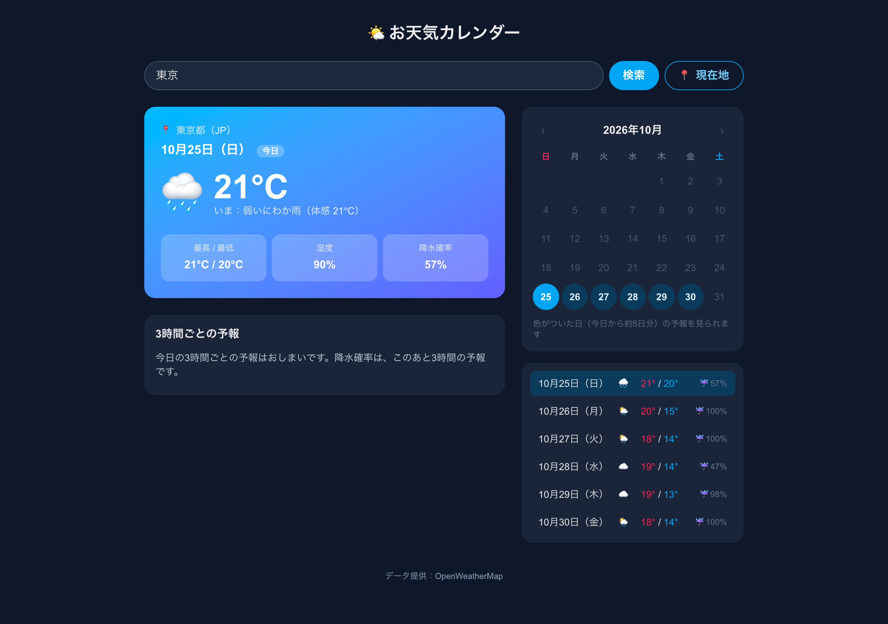
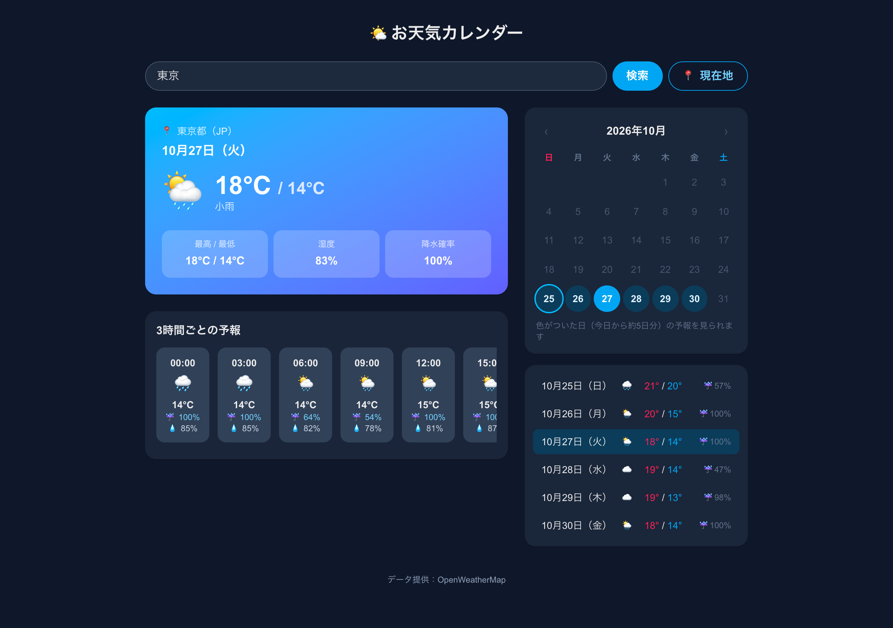
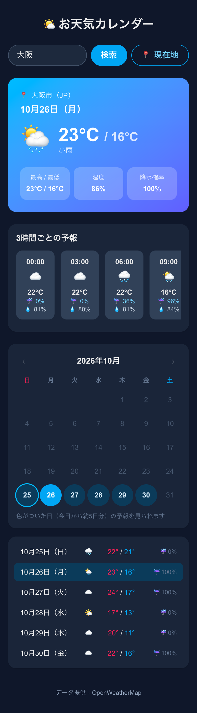
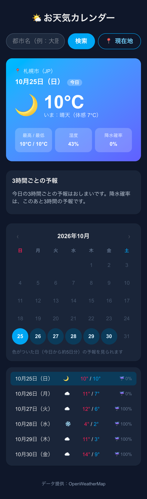
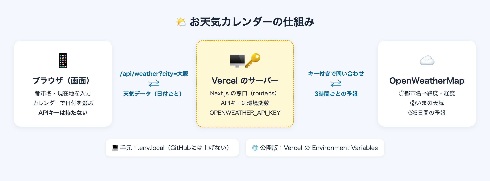

# [課題提出] 天気予報 API と連携した Web アプリの実装課題を完成させました

> このファイルは提出記事の原稿です（`zsh docs/copy_article.sh` で写真ごとコピーできます）。

## A. 課題概要

### 課題情報

- 課題名：実践編 課題1-0-2　天気予報 API（OpenWeatherMap など、無料で使えるもの）と連携した Web アプリを Claude Code で作ろう
- 難易度：★★★☆☆（5段階で自己評価）

### 課題要件

- 任意の都市 or 現在地の、気温・天気・湿度・降水確率などを表示する
- カレンダー機能で、日付を選んで予報を切り替えられる（週間予報の中から該当日を表示でも OK）
- API キーは必ず環境変数（.env.local）で管理し、コードに直書きしない
- GitHub にリポジトリを作り、Vercel にデプロイする（環境変数も Vercel 側で設定）

### ソースコード

- GitHub：https://github.com/Usuke3122378/weather-next
- Google Drive：なし
- 公開URL：https://weather-next-blond.vercel.app/

### 成果物のスクリーンショット

最初に開いた画面（PC）。東京の「いまの天気」と、最高/最低・湿度・降水確率が出る。右にカレンダーと週間のまとめ

週間のまとめから10月27日を選んだところ。上の天気と3時間ごとの予報が、その日のものに切り替わる。カレンダーでも同じ日が選ばれる

スマホで「大阪」と入力して検索し、カレンダーで26日を選んだところ

「📍 現在地」ボタンを押したところ（スクショ撮影のため、テスト用に札幌の位置を設定）。地名も日本語で出る

## B. 実装内容

### 使用技術

- 言語：TypeScript
- フレームワーク：Next.js（App Router、Route Handler）、React、Tailwind CSS
- データベース：なし
- その他ツール：OpenWeatherMap（無料プランの Geocoding API・Current Weather API・5 day / 3 hour Forecast API）、Claude Code（作成・動作確認・スクショ撮影）、GitHub（コード保管）、GitHub CLI（gh。リポジトリ作成と push）、Vercel（公開。環境変数の設定。push すると自動で公開し直す）

### 実装した機能

1. 都市名で検索：「大阪」「札幌」のような日本語でも、「London」のような英語でも検索できる。見つからないときは「『○○』が見つかりませんでした」と出す
2. 現在地の天気：「📍 現在地」ボタンで、ブラウザの位置情報から今いる場所の天気を出す。地名も日本語で表示する
3. 天気の表示：気温・天気（絵文字アイコン）・湿度・降水確率・最高/最低気温。今日を選ぶと「いまの気温」と体感温度も出す
4. 3時間ごとの予報：選んだ日の3時間ごとの気温・天気・降水確率・湿度を、横に並べて表示する
5. カレンダー：今日から約5日分の、予報がある日だけに色が付いて押せる。押すとその日の予報に切り替わる。今日は丸い枠で目立たせる
6. 週間のまとめ：日付ごとの天気・最高/最低気温・降水確率の一覧。押してもその日に切り替わる
7. API キーの管理：キーは .env.local（手元）と Vercel の Environment Variables（公開版）にだけ入れ、コードには書いていない

### 工夫したポイント

- API キーがブラウザから見えないようにしました。画面から OpenWeatherMap を直接呼ぶと、キーが利用者に見えてしまいます。そこで Next.js のサーバー側に自分の窓口（`/api/weather`）を作り、キーはその中だけで使うようにしました。環境変数の名前に `NEXT_PUBLIC_` を付けると画面側にも渡ってしまうので、付けていません。
- 無料でカード登録もいらない API だけを使いました。降水確率まで取れる「One Call API 3.0」はカード登録が必要なので使わず、無料プランの「5 day / 3 hour Forecast」の降水確率（pop）を使いました。
- 3時間ごとの予報を、その都市の時刻で日付ごとにまとめ直しています。1日の天気はお昼（12時）に一番近い時間のもの、降水確率はその日の一番高い値、湿度は平均にしました。
- 夜でも今日の天気が見られるようにしました。夜は今日の3時間ごとの予報が残っていないので、「いまの天気」から今日の分を作り、「今日の3時間ごとの予報はおしまいです」と案内を出します。
- エラーのときは、何が起きたかを日本語で知らせます。たとえば、作ったばかりで使えないキーのときは「作ったばかりのキーは使えるまで最大2時間ほどかかります」と出します。
- スマホでもはみ出さないようにしました。3時間ごとの予報は、その中だけ横にスクロールできます。

## C. 実装過程

### 開発の流れ

#### 10月25日（1）使う API を決めて、プロジェクトを作る

やったこと：課題文を Claude Code に貼り付けて「ステップバイステップでやることを教えて」と頼んだ。OpenWeatherMap に登録して API キーを取り、そのあいだに Next.js のプロジェクト weather-next を作ってもらった。

遭遇したエラー：`（エラーはなし）`

Cursorに聞いた内容：（今回は Claude Code に相談）課題文を貼り付けて、どう進めればよいか聞いた。

Cursorの回答：（Claude Code の回答）OpenWeatherMap の「5 day / 3 hour Forecast」なら、無料でカード登録もいらず、気温・天気・湿度・降水確率がそろう。新しいキーは使えるまで最大2時間ほどかかるので、キーの取得を一番先にやっておく。①キー取得 ②プロジェクト作成 ③.env.local ④サーバー側の窓口 ⑤画面 ⑥カレンダー ⑦手元で確認 ⑧GitHub ⑨Vercel ⑩提出、の10ステップで進める。

実際に試したこと：

1. OpenWeatherMap に登録し、「My API keys」でキーをコピーした
    - 結果：キーが手に入った
2. Claude Code が create-next-app でプロジェクトを作り、サーバー側の窓口・画面・カレンダーまで作った
    - 結果：ビルド（`npm run build`）が通った

学んだこと：時間がかかる準備（キーが使えるようになるまで）を先に始めておくと、待ち時間をむだにしない。

---

#### 10月25日（2）lint に setState の書き方を注意された

やったこと：最初に東京の天気を読み込む処理を、画面が表示されたとき（useEffect）に動くように書いた。

遭遇したエラー：`Error: Calling setState synchronously within an effect can trigger cascading renders  react-hooks/set-state-in-effect`

Cursorに聞いた内容：（Claude Code が lint の結果を確認）

Cursorの回答：（Claude Code の回答）useEffect の中で、すぐに「読み込み中」の状態を書き換えているのが原因。読み込み中は最初から true にしておき、状態の書き換えは、データが届いたあと（then の中）だけにする。

実際に試したこと：

1. 天気を受け取る部分を関数 getWeather に分けて、届いたあとに状態を書き換える形に直した
    - 結果：1回目の直し方ではまだ同じエラーが出た。2回目の直し方でエラーが消えた

学んだこと：前回の ToDo 課題でも同じ注意を受けた。React では「表示したあとにすぐ書き換える」書き方はよくないと覚えておく。

---

#### 10月25日（3）.env.local にキーを入れようとしたらエラー

やったこと：案内どおり、ターミナルで `open -e ~/Projects/weather-next/.env.local` を入力して、ファイルを開こうとした。

遭遇したエラー：`The file /Users/name/Projects/weather-next/.env.localOPENWEATHER_API_KEY=（APIキー） does not exist.`

Cursorに聞いた内容：（Claude Code に）出たエラーをそのまま貼り付けた。

Cursorの回答：（Claude Code の回答）ファイルを開くコマンドの後ろに、キーが続けて貼り付けられてしまい、「その名前のファイルはない」と言われている。キーはこちらで .env.local に入れる。また、キーがターミナルの履歴に残っているので、気になるなら作り直すとよい。

実際に試したこと：

1. Claude Code に .env.local へキーを書き込んでもらい、GitHub に上がらない設定（.gitignore）になっていることも確かめてもらった
    - 結果：ファイルにキーが入った

学んだこと：コマンドを入力する場所と、ファイルの中身を書く場所は別。貼り付ける前に、どこに入力しているかを確かめる。

---

#### 10月25日（4）キーを入れても「Invalid API key」

やったこと：手元で `npm run dev` を実行して、http://localhost:3000 を開いた。

遭遇したエラー：`{"cod":401, "message": "Invalid API key. Please see https://openweathermap.org/faq#error401 for more info."}`

Cursorに聞いた内容：（Claude Code がアプリを通さず、OpenWeatherMap に直接問い合わせて確認）

Cursorの回答：（Claude Code の回答）アプリやキーの貼り方の問題ではなく、キーがまだ使える状態になっていない。作ったばかりのキーは最大2時間ほどかかるので、時間をおいて再読み込みする。

実際に試したこと：

1. しばらく待ってから、ページを再読み込みした
    - 結果：東京の天気が表示された

学んだこと：エラーのときは、アプリを通さず API に直接聞いてみると、どちらに原因があるかを切り分けられる。

---

#### 10月25日（5）GitHub と Vercel で公開する

やったこと：Claude Code に Public のリポジトリ weather-next を作って push してもらった。Vercel で GitHub のリポジトリを Import し、Environment Variables に `OPENWEATHER_API_KEY` を登録してから Deploy した。

遭遇したエラー：`（エラーはなし）`

Cursorに聞いた内容：（Claude Code に）GitHub へ上げる前に、キーが入っていないか確認してほしいと頼んだ。

Cursorの回答：（Claude Code の回答）上げる中身に .env.local もキーの文字列も入っていないことを確認した。Vercel では、Deploy の前に Environment Variables にキーを登録する。入れ忘れたら、登録してから Redeploy する。

実際に試したこと：

1. 公開URLを開いて、表示・検索・現在地・日付の切り替えを試した
    - 結果：すべて動いた

学んだこと：.env.local は GitHub に上げないので、公開先（Vercel）にも別にキーを登録する必要がある。

---

#### 10月25日（6）夜になったら今日の天気が出なくなった

やったこと：提出記事用に、21時ごろ公開版を確認した。

遭遇したエラー：`（エラーはなし）カレンダーの最初の日が明日（26日）になっていて、今日の「いまの天気」が表示されなかった`

Cursorに聞いた内容：（Claude Code が公開版の API の返事を確認）

Cursorの回答：（Claude Code の回答）5 day / 3 hour Forecast は「これから先」の3時間ごとの予報なので、夜になると今日の分が残っていない。今日の分がないときは、「いまの天気」から今日の分を作る。降水確率は、このあと3時間の予報を使う。

実際に試したこと：

1. サーバー側の窓口で今日の分を足すように直して、commit・push した
    - 結果：夜でもカレンダーで今日が選べて、いまの気温・湿度が出るようになった

学んだこと：時間で中身が変わるデータは、朝・昼・夜など時間を変えて確かめる必要がある。

---

#### 10月25日（7）スマホで画面が右にはみ出していた

やったこと：Claude Code に、スマホ幅（390px）で公開版のスクショを撮ってもらった。

遭遇したエラー：`（エラーはなし）画面全体が右にはみ出して、見出しや入力欄が左に寄っていた。カレンダーの丸が大きすぎた。「☔100%」が2行に折れていた`

Cursorに聞いた内容：（Claude Code がスクショを確認）

Cursorの回答：（Claude Code の回答）横に長い「3時間ごとの予報」の列に、画面全体の幅が引っぱられている。列の幅が中身より広がらない設定（`minmax(0,1fr)`、`min-w-0`）にする。カレンダーの丸は最大44pxにし、パーセントの文字は折り返さない設定にする。

実際に試したこと：

1. 直したあと、手元と公開版の両方でスクショを撮り直した
    - 結果：はみ出しがなくなり、3時間ごとの予報だけが横にスクロールするようになった

学んだこと：PC で見てきれいでも、スマホでは崩れることがある。公開したあとにスマホ幅でも確かめる。

---

### 参考にした資料

- 公式ドキュメント：Next.js の「Route Handlers」（プロジェクト内の node_modules/next/dist/docs）、OpenWeatherMap の API ドキュメント（Geocoding API・Current Weather Data・5 day weather forecast）
- 参考記事：
- 動画教材：

## D. 学習の振り返り

### 今回学んだこと

技術的な学び：

- 外部 API を使うときは、「画面 → 自分のサーバー → 外部 API」の順に中継すると、キーを利用者から隠せる（Next.js の Route Handler）
- Next.js では `NEXT_PUBLIC_` が付いた環境変数だけが画面側に渡る。秘密のキーには付けない
- .env.local は手元専用。公開先では Vercel の Environment Variables に同じ名前で登録する
- API の返事は、そのまま使わずに「日付ごと」など画面で使いやすい形にまとめ直す
- 天気予報のように時間で中身が変わるデータは、時間帯によって「今日の分がない」などの抜けが出る

AIツールの使い方：

- エラーは、出た文をそのまま貼り付けると原因を教えてもらえる
- 「アプリが悪いのか、キーが悪いのか」を、API に直接聞いて切り分けてもらえる
- スクショを撮ってもらうと、スマホではみ出すなど、自分では気づかなかった崩れも見つけてもらえる
- ネットに公開する操作（GitHub の Public リポジトリ作成）は、確認されてから自分で OK を出した

開発の進め方：

- 時間がかかる準備（キーが使えるまで）を最初に始めておく
- GitHub に上げる前に、秘密情報が入っていないかを必ず確かめる
- 公開したあとも、時間帯や画面の幅を変えて確かめる

### 作った機能からの発展アイデア

今回作った機能：3時間ごとの気温・降水確率・湿度を表示する機能

発展アイデア：「3時間ごとの予報から、お散歩や洗濯物を外に干すのにちょうどいい時間を教えてくれる機能」

- どんな人に：小さな子どもがいて、毎日お散歩や公園に行く家庭。外に洗濯物を干す人
- どんな時に：朝、今日の予定を決めるとき。「午後は雨が降るかな？」と迷ったとき
- どんなメリットがあるか：3時間ごとの数字を自分で見比べなくても、「10時〜13時がおすすめ（降水確率10%・20℃）」のようにすぐわかる。急な雨で子どもがぬれたり、洗濯物を干し直したりする手間が減る

### 次の課題に向けて

- 今回はいちばん近い5日分だけだったので、もっと先の日（月間など）や過去の天気も見られる API を調べてみたい
- 同じ都市を何度も調べると API を何度も呼ぶので、結果をしばらく保存しておく（キャッシュ）方法を学びたい
- よく見る都市をお気に入りに登録できるようにしたい

---

📝 追加メモ

- 天気予報は OpenWeatherMap の無料プラン（5 day / 3 hour Forecast）を使っているため、カレンダーで選べるのは今日から約5日分です
- API キーは .env.local（GitHub には上げていません）と Vercel の Environment Variables で管理しています。コードには書いていません
- 「現在地」のスクショは、撮影のためにテスト用の位置（札幌）を設定して撮りました
- 公開URLは GitHub と連携しているので、push するたびに自動で更新されます
